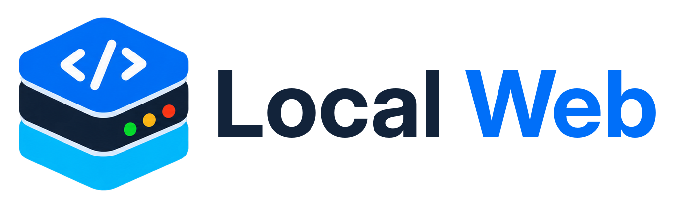

<p align="center">
  
</p>

# LocalWeb

LocalWeb is a **native local development environment for PHP applications**.
It runs directly on your computer and starts the services a project needs:
PHP-FPM, nginx or Apache, MariaDB, MySQL, PostgreSQL or SQLite, Redis,
Mailpit, background workers and scheduled tasks. Each project gets fixed
local ports and its own HTTPS address, such as `https://my-project.test`.

LocalWeb does not use Docker or a virtual machine. Your application stays in
the folder where you already develop it; LocalWeb does not copy, scaffold or
rewrite it. Configuration, databases, certificates, logs and snapshots live
in your user data directory instead.

It is meant for WordPress, Laravel, Symfony, Drupal, another PHP framework or
CMS, or a custom PHP application. Presets are shortcuts, not a list of
supported applications. **Generic PHP** lets you choose the document root,
database, cache, worker command and scheduled tasks yourself. Your
application's requirements still decide which PHP and database versions it
can use.

### The words used in this README

- **Project** — one registered source folder plus the PHP version, web
  server and services LocalWeb starts for it. Adding a project does not move
  or modify its files.
- **Runtime** — the PHP version and supporting tools (Composer, Node.js,
  database clients) used by a project. The Ubuntu and Arch packages bundle
  them; macOS and Windows use native installations described below.
- **Local domain** — a hostname such as `my-project.test` or
  `my-project.dev` that LocalWeb maps to your machine. Its HTTPS
  certificate is issued by the LocalWeb development CA.
- **Daemon** — the background process that owns projects and services. The
  desktop app, the `localweb` command and `localweb-mcp` all talk to this
  same daemon, so they see the same state and apply the same checks.

### Reading the examples

Examples use `my-project` as a placeholder for the name you choose,
`~/Code/my-project` as its source folder, and `my-project.dev` or
`my-project.test` as its local domain. No project called "my-project" exists
by default: replace the name, folder and domain with your own values.

**Download the latest verified build from the
[releases page](../../releases/tag/rolling):**
[Ubuntu](../../releases/download/rolling/localweb-ubuntu-amd64.deb) ·
[Arch / Omarchy](../../releases/download/rolling/localweb-arch-x86_64.pkg.tar.zst) ·
[macOS](../../releases/download/rolling/LocalWeb-macos-universal.pkg) ·
[Windows](../../releases/download/rolling/localweb-windows-x86_64.zip)

These links always point to the latest successful `main` build for all four
platforms. The release notes list its version, source commit and checksums.
Builds are published after testing, so a push may take time to appear here.
[Stable releases](../../releases/latest) are separate snapshots.

## Quick start

1. Install the package for your OS from the links above, open the desktop
   app and choose **Set up LocalWeb**. In a terminal the equivalent is:
   ```bash
   localweb setup
   localweb ca install
   ```
2. Register an existing PHP application folder. In the desktop app choose
   **Add project**; from the CLI run:
   ```bash
   localweb project add ~/Code/my-project --php 8.5 --web nginx \
     --db mariadb --document-root public --domain my-project.test
   ```
3. Put the generated connection values into the application's own
   configuration (`.env`, `wp-config.php`, and so on). Do not edit LocalWeb
   files instead:
   ```bash
   localweb env my-project --format dotenv
   ```
   Set the application's base URL to the LocalWeb HTTPS address, for example
   `https://my-project.test`.
4. Start the project and open that address. The desktop app provides the
   same **Start** and **Open** actions:
   ```bash
   localweb project start my-project
   ```

Stopping a project stops its services but keeps the project and its data.
Removing a project deletes LocalWeb's configuration for it, not the source
folder or the database.

## Tools and features

| Tool | What LocalWeb provides |
| --- | --- |
| **PHP 8.0–8.5** | Per-project CLI and PHP-FPM selection. PHP 8.0 and 8.1 are end-of-life compatibility versions and receive no upstream security fixes; 8.2 is in security-only support until 31 Dec 2026. Use a supported branch for current work. The desktop indicates which versions are included. PHP 8.6 will be added after its stable release. Bundled Linux runtimes include the `redis` (phpredis) extension, and Laravel projects may use `predis/predis` instead. |
| **nginx** | Per-project web configuration for a LEMP stack. |
| **Apache 2.4** | Per-project web configuration for a LAMP stack; can run alongside nginx. |
| **MariaDB** | Shared local server with a database and credentials for each project; the reference payload uses MariaDB 11.8 LTS. |
| **MySQL** | Shared local server with a database and credentials for each project; the reference payload uses MySQL 8.4 LTS. |
| **PostgreSQL** | Private local cluster with a database and login for each project. |
| **SQLite** | A LocalWeb-owned database file for each project, accessed through PHP. |
| **Database management** | Database-only snapshots, checksum-verified restore, SQL export and confined SQL import for every database project, shared by the desktop app, CLI and MCP server. |
| **Redis** | A separate local cache process for each project. |
| **Composer 2** | Runs with the project's selected PHP. |
| **Node.js 24, npm and npx** | Bundled LTS build tools. Node.js 22 and 20 can also be selected when matching system installations are available; Node.js 20 is EOL. |
| **Mailpit** | Per-project SMTP server and browser inbox for development email. |
| **Background workers** | Supervisor-style process management using the native service manager; Laravel queue and Symfony Messenger presets, or a custom executable and arguments. |
| **Scheduled tasks** | Five-field cron schedules, framework presets, logs and overlap protection while the project is active. |
| **Local domains** | Exact project entries in `/etc/hosts`, with `.dev` as the default suffix. |
| **Direct ports and HTTPS domains** | Every project gets a fixed loopback HTTP port (18000–18999) and, for network databases, a fixed loopback database port (19000–19999) forwarded to the shared engine. The TLS gateway uses its own local endpoint, so other local stacks keep their default ports. |
| **Desktop app** | Explicit project details, edit and delete actions, runtime/service selection, start/stop/restart, browser and Mailpit opening, connection settings, offline project creation, a remembered window position, and a system tray that keeps LocalWeb available after closing the window. |
| **CLI** | Project management, PHP/Composer/Node commands, shell access, environment values and diagnostics. |
| **AI assistants (MCP)** | A Model Context Protocol server (`localweb-mcp`) that lets AI assistants create, start, inspect and test projects through the same daemon as the desktop app. |
| **Autostart** | Optional login startup and per-project startup preferences. |

The Linux build pipeline assembles all six PHP CLI/FPM pairs from the
pinned sources in `packaging/php-sources.txt`. A smaller development package
may include only PHP 8.5. Selecting another version does not download it:
its matching CLI and FPM must already be in the runtime or on the system.
PostgreSQL likewise needs its complete runtime payload and PHP's
`pdo_pgsql` extension. **Memcached is not implemented.**

See [architecture](ARCHITECTURE.md) for the runtime layout.

## Platforms and distribution

LocalWeb's source, changes and downloadable packages are published **only
on GitHub**. There is no LocalWeb package in a distro repository, AUR or
COPR. OS packages and upstream downloads are build inputs, not alternative
LocalWeb distribution channels.

| Platform | Package | Native integration |
| --- | --- | --- |
| Ubuntu 26.04 amd64 | `.deb` | systemd, system certificate store and system authorization |
| Arch Linux amd64 | `.pkg.tar.zst` | systemd, Arch certificate store and system authorization |
| Omarchy amd64 | Arch package | Uses the same Arch base and integration |
| macOS 12+ arm64/x86_64 | `.pkg` (universal) | launchd agents and system keychain trust for the development CA |
| Windows 10/11 x86_64 | `.zip` (portable) | Named pipes, scheduled task and user certificate store |

Ubuntu and Arch packages include LocalWeb's private web stack. The macOS
installer and Windows ZIP contain the application binaries; install the
native tools separately through Homebrew or Scoop/Chocolatey. Check
`localweb doctor` before starting a project. A normal desktop session
with the platform service manager (systemd, launchd or Task Scheduler) is
required.

### Validation status

The earlier Ubuntu/PHP 8.5 package has passed live stack and removal tests.
The expanded stack and platform ports are checked by
[Native packages and acceptance](../../actions/workflows/native-builds.yml).
For the source revision you are installing, check that its platform job
passed. Arch CI covers the base used by Omarchy; an Omarchy desktop session
still needs its own final acceptance check. macOS jobs build and smoke the
universal binaries on a macOS runner, and the Windows binaries are
cross-built and exercised under Wine; a final acceptance run on real macOS
and Windows hosts is still pending.

The Linux jobs build and install the package, test PHP 8.0–8.5 with both web
servers and all four database choices, check Redis,
Mailpit and the PHP CLI, then exercises stop, removal and source-folder
preservation. Packages are uploaded as workflow artifacts only after the
job passes. macOS and Windows also run the workspace regression suite on
native runners; Windows runs core and daemon regressions under Wine too.
These checks do not replace native
web-stack acceptance on macOS and Windows. Tagged versions and the rolling pre-release publish the same
files as public release assets.

## Install and get started

Use the OS download links above for the latest verified `main` build, or
choose a versioned [stable release](../../releases/latest).
The [rolling pre-release](../../releases/tag/rolling)
updates after the complete native build passes. Failed builds leave the previous downloads in place. Release assets
download without an account, while the artifacts attached to individual
**Actions** runs require a GitHub sign-in. Check the package's SHA-256 against the accompanying
`SHA256SUMS` file.

```bash
sudo apt install ./localweb-ubuntu-amd64.deb           # Ubuntu
sudo pacman -U ./localweb-arch-x86_64.pkg.tar.zst       # Arch / Omarchy
```

Open the desktop app and choose **Set up LocalWeb**, then **Trust certificate**.
Or use the same workflow from a terminal:

```bash
localweb setup
localweb ca install
localweb start
```

System authorization is used for CA installation, cleanup registration and
local-domain changes. Project services run as your desktop user.
If a browser was already open during certificate setup, restart it so it
reloads its trust store.

## Add your first project

In the desktop app, open **Add project**, select an existing source folder,
check its preset and document root, choose the runtime and services, then
confirm with **Add project**. The folder must already contain the
application: LocalWeb does not download framework code or create a new
application for you. If the folder is empty, create the application with
Composer or your framework's installer first. The source files are kept
where they are.
Before starting, open **Details → Show connection settings** and copy the
database, Redis and email values into your app's configuration. Update its
base URL to the LocalWeb HTTPS URL shown in Details. LocalWeb leaves your
source files and existing databases in place; it does not import data from
another development stack. The Ubuntu and Arch packages bundle `phpredis` in
every PHP runtime, so Laravel's default `REDIS_CLIENT=phpredis` works there.
On macOS and Windows, enable the PHP `redis` extension provided with your PHP
installation, or use `predis/predis`. Copy `REDIS_HOST` and `REDIS_PORT` from
**Show connection settings** into `.env`; LocalWeb passes the same values to
CLI commands and workers. Then select **Start** and **Open**.

## Project CRUD

Every project exposes the same four operations in the desktop app and in the
CLI:

| Operation | Desktop | CLI |
| --- | --- | --- |
| Create | **Add project** | `localweb project add <path>` |
| Read | **Details** on the project row, or `localweb project list` | `localweb project info <name>` |
| Update | **Edit** on the project row | `localweb project update <name>` |
| Delete | **Remove** on the project row | `localweb project remove <name>` |

The row actions are always visible, including in the narrow stacked layout.
**Edit** opens the full settings form; **Remove** asks for confirmation.
Deleting an active project stops it first, then removes its LocalWeb
configuration, local domain and project-owned runtime artifacts. The source
folder and database data are always retained.

`localweb project update` changes only the flags you pass. Name, path,
hostname, project identifier, environment variables, resource limits and
creation time are preserved. The same applies to the desktop edit form.
For example:

```bash
localweb project update my-project --php 8.4 --web apache
localweb project update my-project --db postgres --cache redis --mail
localweb project update my-project --no-mail --no-autostart
localweb project update my-project --clear-cron
localweb project update my-project --cron '*/10 * * * * @php artisan schedule:run'
```

`--supervisor` enables the profile worker preset, `--no-supervisor` disables
the worker, and `--supervisor-command` replaces it. Without one of these
flags the current worker configuration is kept.

For a terminal workflow:

```bash
localweb project add ~/Code/my-project --php 8.5 --web nginx \
  --db mariadb --cache redis --document-root public --domain my-project.dev
localweb env my-project --format dotenv
# Apply these values to the app's config; import existing data if needed.
localweb composer my-project -- install
localweb project start my-project
localweb php my-project -- -v
```

Choose a different stack for another project:

```bash
localweb project add ~/Code/blog --php 8.3 --web apache \
  --db postgres --document-root public --domain blog.dev
localweb project start blog
```

PHP 8.3 and PostgreSQL must be present in the installed runtime for that
example. **Details → Show connection settings** gives you the database,
Redis and email values. **Copy as .env** copies them; LocalWeb does not edit
your app's configuration file. From the CLI:

```bash
localweb env my-project --format dotenv
```

Start prints the direct URL (`http://127.0.0.1:<web port>`); pin the ports
with `--web-port` and `--db-port`, or let LocalWeb allocate them from the
fixed ranges above. `localweb project info <name>` shows both endpoints, and
the environment values expose the database proxy port as `DB_PORT`.

The HTTPS gateway runs locally as part of LocalWeb and is managed by the
daemon. `localweb status` shows the addresses and ports in use, and
`localweb doctor` reports setup problems. `localweb ca install` adds the
public development CA to the trust stores used by the current platform.
Restart browsers that were open during the first installation.

## Background work

| Preset | Worker | Scheduled task |
| --- | --- | --- |
| Laravel | `artisan queue:work` | `artisan schedule:run` every minute |
| Symfony | `bin/console messenger:consume async` | Supply a schedule if your app needs one |
| WordPress | Custom command if needed | `wp-cron.php` every five minutes; disable WordPress's page-triggered cron in your app configuration |
| Drupal | Custom command if needed | `vendor/bin/drush cron` every fifteen minutes; install Drush in the project |
| Other apps | Custom executable and arguments | Custom schedule and command |

Enable a preset with `--supervisor` or `--cron-preset`. A custom worker uses
`--supervisor-command` and one `--supervisor-arg` per literal argument.
`@php` uses the project's selected PHP and private PHP configuration.
The desktop exposes the same presets and custom-command fields.

## Common commands

```bash
localweb status
localweb doctor
localweb runtime list
localweb project list
localweb project info my-project
localweb project update my-project --php 8.4
localweb project restart my-project
localweb project stop my-project
localweb project remove my-project
localweb node my-project -- --version
localweb npm my-project -- run build
localweb npx my-project -- --version
localweb exec my-project -- php artisan about
localweb shell my-project
localweb db snapshot create my-project --name before-migration
localweb db export my-project ~/Backups/my-project.sql.zst
localweb autostart enable
localweb shutdown
```

Closing the desktop window keeps LocalWeb running in the system tray on
Linux, macOS and Windows. Clicking the tray icon shows **Open** and **Quit desktop app**:
**Open** restores the window, while **Quit desktop app** closes the desktop app only.
The daemon and running projects keep working, so **Stop LocalWeb** remains
the way to stop the managed environment; **Stop** on a project affects that
project. On a Linux desktop without a StatusNotifier watcher, closing the
window exits normally instead of hiding an unreachable app.
The displayed project state is the daemon's active-project state, not a
continuous health check of every service. When a project starts or restarts,
the daemon reads a bounded HTTP/1.x status line from its direct loopback port:
2xx/3xx and authentication challenges (401/403) count as reachable, while
404, 5xx, malformed responses and timeouts fail the start. An HTTP 500 means
the app returned an error: check its logs and the values from `localweb env <name>`.
Gateway state is
checked through the native service manager. Worker counts describe configured
workers.

## Database snapshots and SQL files

Every project with a database has database-only snapshots, restore, SQL
export and SQL import. Open **Details → Database Management** in the desktop
app, or use the same operations from the CLI:

```bash
localweb db snapshot create my-project --name before-migration
localweb db snapshot list my-project
localweb db snapshot restore my-project --latest --yes
localweb db snapshot restore my-project before-migration --no-safety --yes
localweb db snapshot delete my-project before-migration --yes
localweb db snapshot cleanup my-project --yes

localweb db export my-project ~/Backups/my-project.sql.zst
localweb db export my-project --stdout --compression gzip > my-project.sql.gz
localweb db import my-project ~/Backups/my-project.sql.zst --yes
localweb db import my-project ~/Backups/partial.sql --no-drop --yes
```

Snapshots contain database state only. They never include project files, PHP
or web-server configuration, Redis data, Mailpit messages or certificates.
MariaDB, MySQL and PostgreSQL snapshots are logical SQL dumps; SQLite
snapshots use the online backup API. All payloads are Zstandard-compressed,
checksummed and published atomically under the platform data directory
(`~/.local/share/localweb/databases/snapshots/` on Ubuntu, Arch/Omarchy and
macOS, `%LOCALAPPDATA%\LocalWeb\data\databases\snapshots\` on Windows).

Restore verifies the checksum, engine and major version before changing data,
creates a safety snapshot first by default, and verifies the database after
the restore. `--latest` selects the newest normal snapshot; safety snapshots
must be named explicitly. Export supports `.sql`, `.sql.gz` and `.sql.zst`,
never replaces an existing file unless `--force` is passed, and `--stdout`
writes only data to standard output. Import replaces existing objects by
default, supports `--no-drop` and a safety snapshot, and validates the whole
dump before modifying anything.

Imports are confined to the project database with project-scoped
credentials. Cross-database and administrator commands, client shell
commands, path traversal and decompression bombs are rejected before any
change. MySQL and MariaDB DDL is not atomic, so use a safety snapshot or a
`--single-transaction` PostgreSQL workflow where rollback matters. See
[database management](docs/database-management.md) for the full rules,
storage layout, engine behaviour and troubleshooting.

## Shell integration

`localweb integration install` puts `php`, `composer`, `node`, `npm` and `npx`
on your `PATH` and makes them follow the folder you are in:

```bash
cd ~/code/my-project
php -v            # the PHP version configured for my-project
composer install  # Composer running with that same PHP

cd ~
php -v            # the PHP installed by your operating system
```

The command creates the shims in the LocalWeb data directory and adds one
delimited block to the startup file of your login shell (`~/.zshrc`,
`~/.bashrc`, `~/.bash_profile`, `~/.profile` or
`~/.config/fish/config.fish`). Nothing outside that block is edited. On
Windows the same directory is added to the user `PATH` and the shims are
generated `.cmd` files; a PHP installation listed in the machine-wide `PATH`
takes precedence there, so remove it from that list if you want the LocalWeb
shims to win. Open a new terminal afterwards, or `source` the file the command
reports. Reinstalling is safe; the block is replaced in place.

Resolution order is deliberate:

1. `LOCALWEB_PROJECT`, which `localweb shell` exports.
2. The deepest registered project that contains the current folder, so a
   project nested inside another one owns its own subtree.
3. The tool installed on your system.

Outside every project, or while the daemon is not running, the shim runs the
system tool instead of failing. When the daemon cannot answer, the fallback
prints a short notice on stderr, and only if stderr is a terminal, so scripts,
IDE tasks and pipelines stay quiet. An explicit `LOCALWEB_PROJECT`, which is
how `localweb shell` marks its sessions, stays strict instead: a stopped daemon
is reported rather than hidden. `LOCALWEB_NO_SHIM=1` bypasses the shims for a
single command, and the explicit forms keep working:
`localweb php my-project -- -v` and `localweb exec my-project -- php artisan about`.

```bash
localweb integration status
localweb integration remove
```

Installing the package never edits shell startup files: the integration is
opt-in, and `localweb integration remove` deletes the shims and the managed
block it created.

## AI assistants (MCP)

The package installs `localweb-mcp`, a Model Context Protocol server that
exposes the LocalWeb daemon over stdio. Point any MCP-capable client at the
binary to let an assistant create a project, start it, run `composer`,
framework commands or tests inside the project runtime, read logs and open
the environment values. The tool set covers status and diagnostics, daemon
start/stop, project add/remove/start/stop/restart, `@php`/`@composer`/`@node`/
`@npm`/`@npx` command execution, environment, runtime list, certificate
status/installation, hosts synchronization, login autostart, and database
snapshots, restore, export and import. Destructive database tools require an
explicit `"confirm": true`.

The desktop **Settings** view shows the resolved `localweb-mcp` path, copies
the configuration below, and lists the active environment values.

```json
{
  "mcpServers": {
    "localweb": {
      "command": "localweb-mcp"
    }
  }
}
```

The assistant connects to the same user daemon as the desktop app; start
LocalWeb once (`localweb start`) or use the `localweb_daemon_start` tool.
Privileged steps (CA installation, `/etc/hosts` changes) still require the
normal polkit authentication.

## Remove LocalWeb

```bash
sudo apt remove localweb     # Ubuntu
sudo pacman -R localweb      # Arch / Omarchy
```

Package removal stops LocalWeb's services and removes its system integration,
binaries, logs and host mappings. **Per-user data is preserved:** projects,
databases, settings, generated certificates and the private CA keys are never
deleted by `apt remove` or `pacman -R`, and upgrades keep them as well.
To erase this account's LocalWeb data explicitly:

```bash
localweb ca remove              # remove this account's CA from system trust
localweb data purge --dry-run   # list directories and sizes
localweb data purge             # requires typing "purge" to confirm
```

`localweb data purge` only removes directories owned by the calling account
and refuses symlinked paths. Source project folders outside LocalWeb data
directories are never touched. If you enabled the shell integration, run
`localweb integration remove` before removing the package, so the shim
directory and the managed shell block disappear too.

## Build

Use stable Rust. The runtime staging tools need Python 3 on the **build
host**; the installed application does not use Python, Electron or a
browser shell.

```bash
cargo build --release --workspace
cargo test --workspace --all-targets
```

Packaging scripts are under `packaging/` and `scripts/`. See
[architecture](ARCHITECTURE.md) and [security](SECURITY.md) for the runtime
layout and security model.
